# Enterprise Customer Intelligence

Production-oriented customer analytics for transaction validation, customer behavior features, churn-risk classification, customer-value regression, segmentation, anomaly detection, model comparison, tuning, calibration, and explainability.

> **Reproducibility note:** The numerical results below are extracted from the generated artifacts currently present under `reports/`.

## Dataset and validation

### Dataset profile

| Metric | Value |
|---|---|
| Row Count | 541910 |
| Column Count | 11 |
| Exact Duplicate Rows | 5268 |
| Invoice Date Min | 2010-12-01T08:26:00 |
| Invoice Date Max | 2011-12-09T12:50:00 |
| Valid Invoice Date Count | 541910 |
| Invalid Invoice Date Count | 0 |
| Unique Customers Non Missing | 4372 |
| Missing Customer Id Count | 135080 |
| Unique Invoices Non Missing | 25900 |
| Cancellation Invoice Line Count | 9288 |
| Missing Invoice No Count | 0 |
| Negative Quantity Line Count | 10624 |
| Invalid Quantity Count | 0 |
| Nonpositive Unit Price Line Count | 2517 |
| Invalid Unit Price Count | 0 |
| Total Line Value Including Negative Lines | 9747765.9 |

### Validation result

| Metric | Value |
|---|---|
| Status | PASSED |
| Raw Path | data\raw\online_retail_ii.csv |
| Normalized Path | data\processed\transactions_normalized.csv |
| Raw Rows | 541910 |
| Normalized Rows | 541910 |
| Row Count Preserved | true |
| Valid Invoice Date Ratio | 1 |

## Evaluation protocol

- Chronological train/validation/test splitting prevents future-information leakage.
- Churn is a 30-day inactivity classification task.
- Customer value is 90-day net purchase value in GBP.
- Classification scores include PR-AUC / average precision, ROC-AUC, Brier score, accuracy, precision, recall, F1, confusion counts, and capacity metrics where available.
- Regression scores include MAE, RMSE, R?, and top-decile value metrics where available.
- Test data is reserved for final evaluation and is not used for selection, tuning, calibration, thresholding, or explanation.

## Model comparison scores

### `reports/phase3/churn_model_comparison.csv`

| task | model | status | cv_pr_auc_mean | cv_pr_auc_std | cv_roc_auc_mean | selection_pr_auc | selection_roc_auc | selection_brier_uncalibrated | selection_recall_at_capacity | selection_precision_among_contacted | cv_errors | test_pr_auc | test_roc_auc | test_recall_at_capacity | test_precision_among_contacted | test_brier_score | frozen_threshold |
|---|---|---|---|---|---|---|---|---|---|---|---|---|---|---|---|---|---|
| churn | svm_rbf | PASSED | 0.5089477953912576 | 0.0241326526059612 | 0.6355826904984989 | 0.7270542793364649 | 0.6643644006795082 | 0.2518927836229613 | 0.1339207048458149 | 0.7916666666666666 |  | 0.7583652964909775 | 0.6546896651809526 | 0.12506856829402085 | 0.8028169014084507 | 0.21544391440094302 | 0.345143709706754 |
| churn | voting | PASSED | 0.5008605965562025 | 0.0398332100419147 | 0.6402599112941914 | 0.7145075397581621 | 0.6707863292159743 | 0.2416304434223312 | 0.1277533039647577 | 0.7552083333333334 |  |  |  |  |  |  |  |
| churn | extra_trees | PASSED | 0.5052055238232925 | 0.0190132005028791 | 0.6360916883136235 | 0.7140123710708605 | 0.6623546687397426 | 0.2357627835366039 | 0.1295154185022026 | 0.765625 |  |  |  |  |  |  |  |
| churn | gradient_boosting | PASSED | 0.492578915821531 | 0.0693142587555193 | 0.6341980835894254 | 0.7132796145360973 | 0.6693328726497941 | 0.2547082827513375 | 0.1330396475770925 | 0.7864583333333334 |  |  |  |  |  |  |  |
| churn | random_forest | PASSED | 0.4923911402165172 | 0.0515016128993458 | 0.6321424030904996 | 0.7129436442271385 | 0.659993665601336 | 0.2384739451388726 | 0.1268722466960352 | 0.75 |  |  |  |  |  |  |  |
| churn | xgboost | PASSED | 0.4985188727215793 | 0.0409442334397103 | 0.6521169878121647 | 0.7122793344702553 | 0.6628758169934641 | 0.2657122435221321 | 0.1268722466960352 | 0.75 |  |  |  |  |  |  |  |
| churn | hist_gradient_boosting | PASSED | 0.4920993860108392 | 0.039374534381517 | 0.6362375893802279 | 0.7117241416788126 | 0.6623771270622787 | 0.2717645355432668 | 0.1259911894273127 | 0.7447916666666666 |  |  |  |  |  |  |  |
| churn | catboost | PASSED | 0.4961386673607711 | 0.030530534686941 | 0.6450237248973292 | 0.705289974562511 | 0.6612340560306356 | 0.2640784926224649 | 0.1233480176211453 | 0.7291666666666666 |  |  |  |  |  |  |  |
| churn | svm | PASSED | 0.5009243294177922 | 0.0341141058037838 | 0.6174576924656797 | 0.7052854047082058 | 0.6552820247041548 | 0.2558005235740885 | 0.1348017621145374 | 0.796875 |  |  |  |  |  |  |  |
| churn | lightgbm | PASSED | 0.498265332944894 | 0.0167080427350036 | 0.6375327035087852 | 0.7049286018472629 | 0.6495396043880108 | 0.2942143897025453 | 0.1277533039647577 | 0.7552083333333334 |  |  |  |  |  |  |  |
| churn | adaboost | PASSED | 0.4715528448426097 | 0.0709267396801595 | 0.6167900806159645 | 0.7002924501112429 | 0.6563571449137657 | 0.2892753270350521 | 0.1251101321585903 | 0.7395833333333334 |  |  |  |  |  |  |  |
| churn | decision_tree | PASSED | 0.460607026580595 | 0.0236397923823288 | 0.5942407481048031 | 0.6946816627199416 | 0.6383991247012756 | 0.25162130505858 | 0.1171806167400881 | 0.6927083333333334 |  |  |  |  |  |  |  |
| churn | logistic_regression | PASSED | 0.4923489441139241 | 0.0265585063998716 | 0.6205920259914083 | 0.6884316971822213 | 0.6482934554144714 | 0.2464341748640807 | 0.1233480176211453 | 0.7291666666666666 |  |  |  |  |  |  |  |
| churn | knn | PASSED | 0.4740931903039572 | 0.0021301570510654 | 0.5984446502663354 | 0.686114888997006 | 0.6239872160317872 | 0.268861152019163 | 0.1180616740088105 | 0.6979166666666666 |  |  |  |  |  |  |  |
| churn | naive_bayes | PASSED | 0.4349872418129364 | 0.0874143276919192 | 0.5514119288088932 | 0.6798591686484365 | 0.6300394460280441 | 0.5758463974825611 | 0.1180616740088105 | 0.6979166666666666 |  |  |  |  |  |  |  |
| churn | dummy | PASSED | 0.3916587382903981 | 0.0537807905699736 | 0.5 | 0.5973684210526315 | 0.5 | 0.2650379732491552 | 0.0942731277533039 | 0.5572916666666666 |  |  |  |  |  |  |  |

### `reports/phase3/churn_model_comparison_core.csv`

| task | model | status | cv_pr_auc_mean | cv_pr_auc_std | cv_roc_auc_mean | selection_pr_auc | selection_roc_auc | selection_brier_uncalibrated | selection_recall_at_capacity | selection_precision_among_contacted | cv_errors |
|---|---|---|---|---|---|---|---|---|---|---|---|
| churn | svm_rbf | PASSED | 0.5089477953912576 | 0.02413265260596122 | 0.6355826904984989 | 0.7270542793364649 | 0.6643644006795082 | 0.2518927836229613 | 0.13392070484581498 | 0.7916666666666666 |  |
| churn | voting | PASSED | 0.5008605965562025 | 0.0398332100419147 | 0.6402599112941914 | 0.7145075397581621 | 0.6707863292159743 | 0.24163044342233123 | 0.1277533039647577 | 0.7552083333333334 |  |
| churn | extra_trees | PASSED | 0.5052055238232925 | 0.0190132005028791 | 0.6360916883136235 | 0.7140123710708605 | 0.6623546687397426 | 0.2357627835366039 | 0.12951541850220263 | 0.765625 |  |
| churn | gradient_boosting | PASSED | 0.49257891582153107 | 0.06931425875551932 | 0.6341980835894254 | 0.7132796145360973 | 0.6693328726497941 | 0.25470828275133756 | 0.13303964757709252 | 0.7864583333333334 |  |
| churn | random_forest | PASSED | 0.4923911402165172 | 0.05150161289934588 | 0.6321424030904996 | 0.7129436442271385 | 0.659993665601336 | 0.23847394513887266 | 0.12687224669603525 | 0.75 |  |
| churn | xgboost | PASSED | 0.49851887272157935 | 0.04094423343971037 | 0.6521169878121647 | 0.7122793344702553 | 0.6628758169934641 | 0.26571224352213213 | 0.12687224669603525 | 0.75 |  |
| churn | hist_gradient_boosting | PASSED | 0.4920993860108392 | 0.039374534381517015 | 0.6362375893802279 | 0.7117241416788126 | 0.6623771270622787 | 0.2717645355432668 | 0.12599118942731277 | 0.7447916666666666 |  |
| churn | catboost | PASSED | 0.49613866736077117 | 0.030530534686941047 | 0.6450237248973292 | 0.705289974562511 | 0.6612340560306356 | 0.26407849262246497 | 0.12334801762114538 | 0.7291666666666666 |  |
| churn | svm | PASSED | 0.5009243294177922 | 0.03411410580378386 | 0.6174576924656797 | 0.7052854047082058 | 0.6552820247041548 | 0.25580052357408856 | 0.13480176211453745 | 0.796875 |  |
| churn | lightgbm | PASSED | 0.49826533294489406 | 0.016708042735003675 | 0.6375327035087852 | 0.7049286018472629 | 0.6495396043880108 | 0.2942143897025453 | 0.1277533039647577 | 0.7552083333333334 |  |
| churn | adaboost | PASSED | 0.47155284484260973 | 0.07092673968015956 | 0.6167900806159645 | 0.7002924501112429 | 0.6563571449137657 | 0.28927532703505215 | 0.12511013215859032 | 0.7395833333333334 |  |
| churn | decision_tree | PASSED | 0.46060702658059505 | 0.02363979238232884 | 0.5942407481048031 | 0.6946816627199416 | 0.6383991247012756 | 0.25162130505858 | 0.1171806167400881 | 0.6927083333333334 |  |
| churn | logistic_regression | PASSED | 0.49234894411392416 | 0.026558506399871618 | 0.6205920259914083 | 0.6884316971822213 | 0.6482934554144714 | 0.24643417486408076 | 0.12334801762114538 | 0.7291666666666666 |  |
| churn | knn | PASSED | 0.47409319030395725 | 0.0021301570510654936 | 0.5984446502663354 | 0.686114888997006 | 0.6239872160317872 | 0.26886115201916305 | 0.11806167400881057 | 0.6979166666666666 |  |
| churn | naive_bayes | PASSED | 0.43498724181293646 | 0.08741432769191922 | 0.5514119288088932 | 0.6798591686484365 | 0.6300394460280441 | 0.5758463974825611 | 0.11806167400881057 | 0.6979166666666666 |  |
| churn | dummy | PASSED | 0.3916587382903981 | 0.05378079056997361 | 0.5 | 0.5973684210526315 | 0.5 | 0.2650379732491552 | 0.09427312775330396 | 0.5572916666666666 |  |

### `reports/phase3/churn_model_comparison_tuned_extra_trees.csv`

| task | model | status | cv_pr_auc_mean | cv_pr_auc_std | cv_roc_auc_mean | selection_pr_auc | selection_roc_auc | selection_brier_uncalibrated | selection_recall_at_capacity | selection_precision_among_contacted | cv_errors |
|---|---|---|---|---|---|---|---|---|---|---|---|
| churn | extra_trees | PASSED | 0.5012744848008847 | 0.043116809775131874 | 0.6301413997585836 | 0.7195134074760184 | 0.6614281189715241 | 0.24051313734980148 | 0.13303964757709252 | 0.7864583333333334 |  |

### `reports/phase3/churn_model_comparison_tuned_random_forest.csv`

| task | model | status | cv_pr_auc_mean | cv_pr_auc_std | cv_roc_auc_mean | selection_pr_auc | selection_roc_auc | selection_brier_uncalibrated | selection_recall_at_capacity | selection_precision_among_contacted | cv_errors |
|---|---|---|---|---|---|---|---|---|---|---|---|
| churn | random_forest | PASSED | 0.5021779527753714 | 0.05117194762179513 | 0.6457714099687996 | 0.7117022813711726 | 0.6623730960813106 | 0.24955903664393178 | 0.12511013215859032 | 0.7395833333333334 |  |

### `reports/phase3/churn_model_comparison_tuned_svm_rbf.csv`

| task | model | status | cv_pr_auc_mean | cv_pr_auc_std | cv_roc_auc_mean | selection_pr_auc | selection_roc_auc | selection_brier_uncalibrated | selection_recall_at_capacity | selection_precision_among_contacted | cv_errors |
|---|---|---|---|---|---|---|---|---|---|---|---|
| churn | svm_rbf | PASSED | 0.5077607568362865 | 0.012218528742604356 | 0.6314554989246544 | 0.7237809372293292 | 0.6633002217039532 | 0.25368223124585043 | 0.13392070484581498 | 0.7916666666666666 |  |

### `reports/phase3/churn_model_comparison_tuned_xgboost.csv`

| task | model | status | cv_pr_auc_mean | cv_pr_auc_std | cv_roc_auc_mean | selection_pr_auc | selection_roc_auc | selection_brier_uncalibrated | selection_recall_at_capacity | selection_precision_among_contacted | cv_errors |
|---|---|---|---|---|---|---|---|---|---|---|---|
| churn | xgboost | PASSED | 0.4917566994957246 | 0.0487242838903794 | 0.6441434548300036 | 0.718919735232679 | 0.67213555613141 | 0.2567282892713015 | 0.1277533039647577 | 0.7552083333333334 |  |

### `reports/phase3/segmentation_model_comparison.csv`

| model | status |
|---|---|
| kmeans | PASSED |
| kmeans | PASSED |
| kmeans | PASSED |
| kmeans | PASSED |
| kmeans | PASSED |
| kmeans | PASSED |
| kmeans | PASSED |
| gmm_diag | PASSED |
| gmm_diag | PASSED |
| gmm_diag | PASSED |
| gmm_diag | PASSED |
| gmm_diag | PASSED |
| gmm_diag | PASSED |
| gmm_diag | PASSED |
| agglomerative | PASSED |
| agglomerative | PASSED |
| dbscan | PASSED |
| dbscan | PASSED |
| dbscan | PASSED |
| dbscan | PASSED |

### `reports/phase3/value_model_comparison.csv`

| task | model | status | cv_mae_mean_gbp | cv_mae_std_gbp | cv_rmse_mean_gbp | selection_mae_gbp | selection_rmse_gbp | selection_mse_gbp_squared | selection_r2 | selection_value_tier_metrics | cv_errors | test_mae_gbp | test_rmse_gbp | test_r2 | test_mse_gbp_squared |
|---|---|---|---|---|---|---|---|---|---|---|---|---|---|---|---|
| value | voting_regressor | PASSED | 82.59426801608 | 5.626401866202611 | 335.3566139714097 | 489.23821174726106 | 2362.121093547066 | 5579616.060579985 | 0.0249959873518696 | {"high_positive": {"mae_gbp": 5527.624855318988, "n": 54, "rmse_gbp": 10067.383916174242}, "low_positive": {"mae_gbp": 144.11559438535156, "n": 94, "rmse_gbp": 176.0943051528986}, "medium_positive": {"mae_gbp": 580.9545179962879, "n": 239, "rmse_gbp": 674.7768735879054}, "zero_or_negative": {"mae_gbp": 68.73732764055484, "n": 622, "rmse_gbp": 269.2000872947996}} |  | 291.78304821405663 | 1210.4699292433238 | 0.22144484328681535 | 1465237.4496023376 |
| value | extra_trees_regressor | PASSED | 87.50070218609389 | 12.475484240882128 | 335.227191944414 | 491.37202874186784 | 2386.6776888760446 | 5696230.390578698 | 0.0046183415700558 | {"high_positive": {"mae_gbp": 5597.509852173195, "n": 54, "rmse_gbp": 10174.660632921823}, "low_positive": {"mae_gbp": 149.68751481895865, "n": 94, "rmse_gbp": 172.71600065021585}, "medium_positive": {"mae_gbp": 588.8319821456861, "n": 239, "rmse_gbp": 683.7000033003507}, "zero_or_negative": {"mae_gbp": 62.262660542429394, "n": 622, "rmse_gbp": 261.9860474107415}} |  |  |  |  |  |
| value | gradient_boosting_regressor | PASSED | 85.56654752851927 | 1.4320390057846315 | 363.9235393792325 | 492.8330618653139 | 2378.097038278404 | 5655345.523468517 | 0.0117627237383279 | {"high_positive": {"mae_gbp": 5587.858679842702, "n": 54, "rmse_gbp": 10132.977538666471}, "low_positive": {"mae_gbp": 153.3209646261839, "n": 94, "rmse_gbp": 187.06410436231977}, "medium_positive": {"mae_gbp": 603.8547276096664, "n": 239, "rmse_gbp": 696.9687578633445}, "zero_or_negative": {"mae_gbp": 59.14909989875291, "n": 622, "rmse_gbp": 260.7364217514889}} |  |  |  |  |  |
| value | elastic_net | PASSED | 96.2264348993012 | 26.86847842204437 | 338.4556736377056 | 494.2960299047051 | 2334.505607310414 | 5449916.430563764 | 0.0476602098237736 | {"high_positive": {"mae_gbp": 5462.164736837333, "n": 54, "rmse_gbp": 9945.436258720263}, "low_positive": {"mae_gbp": 151.08658964407152, "n": 94, "rmse_gbp": 171.38023943499505}, "medium_positive": {"mae_gbp": 557.8551553307195, "n": 239, "rmse_gbp": 658.597368858479}, "zero_or_negative": {"mae_gbp": 90.44739040843557, "n": 622, "rmse_gbp": 287.20431589972463}} |  |  |  |  |  |
| value | lasso | PASSED | 101.47529192183616 | 35.03935034373599 | 355.8568813172346 | 494.3531201860008 | 2325.943275296343 | 5410012.119896281 | 0.0546332457101729 | {"high_positive": {"mae_gbp": 5453.717299342271, "n": 54, "rmse_gbp": 9905.983203035787}, "low_positive": {"mae_gbp": 149.17956653855563, "n": 94, "rmse_gbp": 169.44178909884144}, "medium_positive": {"mae_gbp": 563.3677837244626, "n": 239, "rmse_gbp": 662.5004548632612}, "zero_or_negative": {"mae_gbp": 89.44338350228516, "n": 622, "rmse_gbp": 289.59870364994975}} |  |  |  |  |  |
| value | ridge | PASSED | 93.07879323160078 | 21.45520169903373 | 334.13306757523026 | 494.3705082383826 | 2335.4244551009247 | 5454207.385483451 | 0.0469103915173949 | {"high_positive": {"mae_gbp": 5463.767769120548, "n": 54, "rmse_gbp": 9949.534754783857}, "low_positive": {"mae_gbp": 151.13383042550288, "n": 94, "rmse_gbp": 171.44791154064455}, "medium_positive": {"mae_gbp": 557.7742466994641, "n": 239, "rmse_gbp": 658.5020285401658}, "zero_or_negative": {"mae_gbp": 90.45298755442018, "n": 622, "rmse_gbp": 287.07630374325754}} |  |  |  |  |  |
| value | linear_regression | PASSED | 102.24856207634812 | 34.672687714963665 | 356.25942474132074 | 494.4051765706185 | 2325.8760087740184 | 5409699.208190559 | 0.0546879251299342 | {"high_positive": {"mae_gbp": 5453.612296714194, "n": 54, "rmse_gbp": 9905.712953452216}, "low_positive": {"mae_gbp": 148.7299074457061, "n": 94, "rmse_gbp": 169.14992224231247}, "medium_positive": {"mae_gbp": 563.2543624858384, "n": 239, "rmse_gbp": 662.2990463557425}, "zero_or_negative": {"mae_gbp": 89.64848103404476, "n": 622, "rmse_gbp": 289.7276216748694}} |  |  |  |  |  |
| value | random_forest_regressor | PASSED | 86.0271470818553 | 7.098669341283578 | 333.5799103665453 | 494.5126456918288 | 2379.46972175842 | 5661876.156765092 | 0.0106215352407393 | {"high_positive": {"mae_gbp": 5569.469294305218, "n": 54, "rmse_gbp": 10140.316958288257}, "low_positive": {"mae_gbp": 152.72784251039718, "n": 94, "rmse_gbp": 194.41383561755345}, "medium_positive": {"mae_gbp": 584.6868149744871, "n": 239, "rmse_gbp": 678.4316285158444}, "zero_or_negative": {"mae_gbp": 70.92500262973277, "n": 622, "rmse_gbp": 273.9206572313226}} |  |  |  |  |  |
| value | catboost_regressor | PASSED | 81.75958913212261 | 3.0615873570094454 | 343.109536023882 | 496.2179115280992 | 2389.838389621249 | 5711327.528507482 | 0.0019802084260815 | {"high_positive": {"mae_gbp": 5636.543017021462, "n": 54, "rmse_gbp": 10182.438471236488}, "low_positive": {"mae_gbp": 152.52642704734194, "n": 94, "rmse_gbp": 181.69234088139274}, "medium_positive": {"mae_gbp": 602.7145011131, "n": 239, "rmse_gbp": 696.8834757575578}, "zero_or_negative": {"mae_gbp": 60.97154325436001, "n": 622, "rmse_gbp": 268.1541405174882}} |  |  |  |  |  |
| value | dummy_median | PASSED | 41.13120305059524 | 10.80014263114126 | 347.2998114930279 | 497.0202081268583 | 2439.9506682745005 | 5953359.263613181 | -0.0403133670375526 | {"high_positive": {"mae_gbp": 5927.518148148149, "n": 54, "rmse_gbp": 10397.418764797312}, "low_positive": {"mae_gbp": 172.54542553191487, "n": 94, "rmse_gbp": 188.47272327338277}, "medium_positive": {"mae_gbp": 655.8948953974896, "n": 239, "rmse_gbp": 744.3414442816642}, "zero_or_negative": {"mae_gbp": 13.55186495176849, "n": 622, "rmse_gbp": 231.87601764555984}} |  |  |  |  |  |
| value | adaboost_regressor | PASSED | 111.77829585672542 | 20.265387596453994 | 363.5166641144781 | 497.6360289501667 | 2361.58525734272 | 5577084.927698481 | 0.0254382874472914 | {"high_positive": {"mae_gbp": 5461.402588814655, "n": 54, "rmse_gbp": 10059.56258667548}, "low_positive": {"mae_gbp": 138.74259742213056, "n": 94, "rmse_gbp": 172.43831235062046}, "medium_positive": {"mae_gbp": 566.1504415247168, "n": 239, "rmse_gbp": 663.4339548054211}, "zero_or_negative": {"mae_gbp": 94.60973268913047, "n": 622, "rmse_gbp": 296.73971417525}} |  |  |  |  |  |
| value | xgboost_regressor | PASSED | 88.82517679080442 | 5.512974691990388 | 367.9785466939648 | 499.59435980856057 | 2387.2324617722065 | 5698878.826538989 | 0.0041555434741852 | {"high_positive": {"mae_gbp": 5590.032097260909, "n": 54, "rmse_gbp": 10161.590993943326}, "low_positive": {"mae_gbp": 157.38325809817997, "n": 94, "rmse_gbp": 188.8534321250336}, "medium_positive": {"mae_gbp": 604.4568041351737, "n": 239, "rmse_gbp": 698.8583656068689}, "zero_or_negative": {"mae_gbp": 69.08323688941034, "n": 622, "rmse_gbp": 295.0817224486659}} |  |  |  |  |  |
| value | decision_tree_regressor | PASSED | 87.66993220261843 | 7.491715633381919 | 337.7796521450956 | 502.3996242935559 | 2410.447137643301 | 5810255.403372784 | -0.0153068367593169 | {"high_positive": {"mae_gbp": 5648.107893304244, "n": 54, "rmse_gbp": 10260.767621480823}, "low_positive": {"mae_gbp": 142.12283106304835, "n": 94, "rmse_gbp": 160.21106028728695}, "medium_positive": {"mae_gbp": 606.6467353357032, "n": 239, "rmse_gbp": 698.3924220322476}, "zero_or_negative": {"mae_gbp": 70.05671834181521, "n": 622, "rmse_gbp": 306.0515299050933}} |  |  |  |  |  |
| value | hist_gradient_boosting_regressor | PASSED | 101.40892970693218 | 18.672913339158672 | 353.3928226632968 | 502.5228372147123 | 2392.073017865043 | 5722013.322797973 | 0.0001129307857491 | {"high_positive": {"mae_gbp": 5618.039069063314, "n": 54, "rmse_gbp": 10188.779820173862}, "low_positive": {"mae_gbp": 157.17586475478404, "n": 94, "rmse_gbp": 193.21790730443493}, "medium_positive": {"mae_gbp": 596.6166762324522, "n": 239, "rmse_gbp": 689.7792095806575}, "zero_or_negative": {"mae_gbp": 74.44616738540194, "n": 622, "rmse_gbp": 284.88274521798513}} |  |  |  |  |  |
| value | lightgbm_regressor | PASSED | 111.82275416664784 | 19.904328577329508 | 362.00112622642985 | 508.7204874731376 | 2388.1711398587986 | 5703361.393254473 | 0.0033722421704562 | {"high_positive": {"mae_gbp": 5602.40952837, "n": 54, "rmse_gbp": 10163.020298776093}, "low_positive": {"mae_gbp": 154.39842120523682, "n": 94, "rmse_gbp": 191.4229781341114}, "medium_positive": {"mae_gbp": 599.3733065095195, "n": 239, "rmse_gbp": 698.6585889938951}, "zero_or_negative": {"mae_gbp": 85.21733999895234, "n": 622, "rmse_gbp": 302.9560331966113}} |  |  |  |  |  |
| value | polynomial_regression | PASSED | 4611.923685789196 | 3741.173413080704 | 22745.91540611436 | 663.8572341628586 | 2532.5579055277167 | 6413849.544850935 | -0.1207812463893815 | {"high_positive": {"mae_gbp": 5699.49674662343, "n": 54, "rmse_gbp": 10020.94961431354}, "low_positive": {"mae_gbp": 246.55781726549313, "n": 94, "rmse_gbp": 389.74476001296625}, "medium_positive": {"mae_gbp": 799.0263550743147, "n": 239, "rmse_gbp": 1515.4192329474085}, "zero_or_negative": {"mae_gbp": 237.80609528447195, "n": 622, "rmse_gbp": 883.743683447123}} |  |  |  |  |  |

### `reports/phase3/value_model_comparison_core.csv`

| task | model | status | cv_mae_mean_gbp | cv_mae_std_gbp | cv_rmse_mean_gbp | selection_mae_gbp | selection_rmse_gbp | selection_mse_gbp_squared | selection_r2 | selection_value_tier_metrics | cv_errors |
|---|---|---|---|---|---|---|---|---|---|---|---|
| value | voting_regressor | PASSED | 82.59426801608 | 5.626401866202611 | 335.3566139714097 | 489.23821174726106 | 2362.121093547066 | 5579616.060579985 | 0.024995987351869697 | {"high_positive": {"mae_gbp": 5527.624855318988, "n": 54, "rmse_gbp": 10067.383916174242}, "low_positive": {"mae_gbp": 144.11559438535156, "n": 94, "rmse_gbp": 176.0943051528986}, "medium_positive": {"mae_gbp": 580.9545179962879, "n": 239, "rmse_gbp": 674.7768735879054}, "zero_or_negative": {"mae_gbp": 68.73732764055484, "n": 622, "rmse_gbp": 269.2000872947996}} |  |
| value | extra_trees_regressor | PASSED | 87.50070218609389 | 12.475484240882128 | 335.22719194441396 | 491.37202874186784 | 2386.6776888760446 | 5696230.390578698 | 0.004618341570055806 | {"high_positive": {"mae_gbp": 5597.509852173195, "n": 54, "rmse_gbp": 10174.660632921823}, "low_positive": {"mae_gbp": 149.68751481895865, "n": 94, "rmse_gbp": 172.71600065021585}, "medium_positive": {"mae_gbp": 588.8319821456861, "n": 239, "rmse_gbp": 683.7000033003507}, "zero_or_negative": {"mae_gbp": 62.26266054242941, "n": 622, "rmse_gbp": 261.9860474107415}} |  |
| value | gradient_boosting_regressor | PASSED | 85.56654752851927 | 1.4320390057846315 | 363.9235393792325 | 492.8330618653139 | 2378.097038278404 | 5655345.523468517 | 0.011762723738327985 | {"high_positive": {"mae_gbp": 5587.858679842702, "n": 54, "rmse_gbp": 10132.977538666471}, "low_positive": {"mae_gbp": 153.3209646261839, "n": 94, "rmse_gbp": 187.06410436231977}, "medium_positive": {"mae_gbp": 603.8547276096664, "n": 239, "rmse_gbp": 696.9687578633445}, "zero_or_negative": {"mae_gbp": 59.14909989875291, "n": 622, "rmse_gbp": 260.7364217514889}} |  |
| value | elastic_net | PASSED | 96.22643489930121 | 26.86847842204437 | 338.45567363770556 | 494.2960299047051 | 2334.505607310414 | 5449916.430563764 | 0.047660209823773614 | {"high_positive": {"mae_gbp": 5462.164736837333, "n": 54, "rmse_gbp": 9945.436258720263}, "low_positive": {"mae_gbp": 151.08658964407152, "n": 94, "rmse_gbp": 171.38023943499505}, "medium_positive": {"mae_gbp": 557.8551553307195, "n": 239, "rmse_gbp": 658.597368858479}, "zero_or_negative": {"mae_gbp": 90.44739040843557, "n": 622, "rmse_gbp": 287.20431589972463}} |  |
| value | lasso | PASSED | 101.47529192183615 | 35.03935034373599 | 355.8568813172346 | 494.35312018600075 | 2325.943275296343 | 5410012.119896281 | 0.05463324571017292 | {"high_positive": {"mae_gbp": 5453.717299342271, "n": 54, "rmse_gbp": 9905.983203035787}, "low_positive": {"mae_gbp": 149.17956653855563, "n": 94, "rmse_gbp": 169.44178909884144}, "medium_positive": {"mae_gbp": 563.3677837244626, "n": 239, "rmse_gbp": 662.5004548632612}, "zero_or_negative": {"mae_gbp": 89.44338350228516, "n": 622, "rmse_gbp": 289.59870364994975}} |  |
| value | ridge | PASSED | 93.07879323160078 | 21.45520169903373 | 334.13306757523026 | 494.3705082383826 | 2335.4244551009247 | 5454207.385483451 | 0.046910391517394956 | {"high_positive": {"mae_gbp": 5463.767769120548, "n": 54, "rmse_gbp": 9949.534754783857}, "low_positive": {"mae_gbp": 151.13383042550288, "n": 94, "rmse_gbp": 171.44791154064455}, "medium_positive": {"mae_gbp": 557.7742466994641, "n": 239, "rmse_gbp": 658.5020285401658}, "zero_or_negative": {"mae_gbp": 90.45298755442018, "n": 622, "rmse_gbp": 287.07630374325754}} |  |
| value | linear_regression | PASSED | 102.24856207634812 | 34.672687714963665 | 356.25942474132074 | 494.4051765706185 | 2325.8760087740184 | 5409699.2081905585 | 0.054687925129934256 | {"high_positive": {"mae_gbp": 5453.612296714194, "n": 54, "rmse_gbp": 9905.712953452216}, "low_positive": {"mae_gbp": 148.7299074457061, "n": 94, "rmse_gbp": 169.14992224231247}, "medium_positive": {"mae_gbp": 563.2543624858384, "n": 239, "rmse_gbp": 662.2990463557425}, "zero_or_negative": {"mae_gbp": 89.64848103404476, "n": 622, "rmse_gbp": 289.7276216748694}} |  |
| value | random_forest_regressor | PASSED | 86.0271470818553 | 7.098669341283569 | 333.5799103665453 | 494.5126456918288 | 2379.46972175842 | 5661876.156765092 | 0.010621535240739388 | {"high_positive": {"mae_gbp": 5569.469294305218, "n": 54, "rmse_gbp": 10140.316958288257}, "low_positive": {"mae_gbp": 152.72784251039724, "n": 94, "rmse_gbp": 194.41383561755345}, "medium_positive": {"mae_gbp": 584.6868149744871, "n": 239, "rmse_gbp": 678.4316285158444}, "zero_or_negative": {"mae_gbp": 70.92500262973277, "n": 622, "rmse_gbp": 273.9206572313226}} |  |
| value | catboost_regressor | PASSED | 81.75958913212261 | 3.0615873570094454 | 343.109536023882 | 496.21791152809914 | 2389.8383896212486 | 5711327.528507482 | 0.0019802084260815978 | {"high_positive": {"mae_gbp": 5636.543017021462, "n": 54, "rmse_gbp": 10182.438471236488}, "low_positive": {"mae_gbp": 152.52642704734194, "n": 94, "rmse_gbp": 181.69234088139274}, "medium_positive": {"mae_gbp": 602.7145011131, "n": 239, "rmse_gbp": 696.8834757575578}, "zero_or_negative": {"mae_gbp": 60.97154325436001, "n": 622, "rmse_gbp": 268.1541405174882}} |  |
| value | dummy_median | PASSED | 41.13120305059524 | 10.80014263114126 | 347.2998114930279 | 497.0202081268583 | 2439.9506682745005 | 5953359.263613181 | -0.040313367037552617 | {"high_positive": {"mae_gbp": 5927.518148148149, "n": 54, "rmse_gbp": 10397.418764797312}, "low_positive": {"mae_gbp": 172.54542553191487, "n": 94, "rmse_gbp": 188.47272327338277}, "medium_positive": {"mae_gbp": 655.8948953974896, "n": 239, "rmse_gbp": 744.3414442816642}, "zero_or_negative": {"mae_gbp": 13.55186495176849, "n": 622, "rmse_gbp": 231.87601764555984}} |  |
| value | adaboost_regressor | PASSED | 111.77829585672542 | 20.265387596453994 | 363.5166641144781 | 497.6360289501667 | 2361.58525734272 | 5577084.927698481 | 0.025438287447291485 | {"high_positive": {"mae_gbp": 5461.402588814655, "n": 54, "rmse_gbp": 10059.56258667548}, "low_positive": {"mae_gbp": 138.74259742213056, "n": 94, "rmse_gbp": 172.43831235062046}, "medium_positive": {"mae_gbp": 566.1504415247168, "n": 239, "rmse_gbp": 663.4339548054211}, "zero_or_negative": {"mae_gbp": 94.60973268913047, "n": 622, "rmse_gbp": 296.73971417525}} |  |
| value | xgboost_regressor | PASSED | 88.82517679080442 | 5.5129746919903875 | 367.97854669396474 | 499.59435980856057 | 2387.2324617722065 | 5698878.826538989 | 0.00415554347418523 | {"high_positive": {"mae_gbp": 5590.032097260909, "n": 54, "rmse_gbp": 10161.590993943326}, "low_positive": {"mae_gbp": 157.38325809817997, "n": 94, "rmse_gbp": 188.8534321250336}, "medium_positive": {"mae_gbp": 604.4568041351737, "n": 239, "rmse_gbp": 698.8583656068689}, "zero_or_negative": {"mae_gbp": 69.08323688941034, "n": 622, "rmse_gbp": 295.0817224486659}} |  |
| value | decision_tree_regressor | PASSED | 87.66993220261843 | 7.4917156333819195 | 337.7796521450956 | 502.39962429355586 | 2410.447137643301 | 5810255.403372784 | -0.015306836759316989 | {"high_positive": {"mae_gbp": 5648.107893304244, "n": 54, "rmse_gbp": 10260.767621480823}, "low_positive": {"mae_gbp": 142.12283106304835, "n": 94, "rmse_gbp": 160.21106028728695}, "medium_positive": {"mae_gbp": 606.6467353357032, "n": 239, "rmse_gbp": 698.3924220322476}, "zero_or_negative": {"mae_gbp": 70.05671834181521, "n": 622, "rmse_gbp": 306.0515299050933}} |  |
| value | hist_gradient_boosting_regressor | PASSED | 101.40892970693218 | 18.672913339158672 | 353.3928226632968 | 502.5228372147123 | 2392.073017865043 | 5722013.322797973 | 0.0001129307857491435 | {"high_positive": {"mae_gbp": 5618.039069063314, "n": 54, "rmse_gbp": 10188.779820173862}, "low_positive": {"mae_gbp": 157.17586475478404, "n": 94, "rmse_gbp": 193.21790730443493}, "medium_positive": {"mae_gbp": 596.6166762324522, "n": 239, "rmse_gbp": 689.7792095806575}, "zero_or_negative": {"mae_gbp": 74.44616738540194, "n": 622, "rmse_gbp": 284.88274521798513}} |  |
| value | lightgbm_regressor | PASSED | 111.82275416664785 | 19.904328577329508 | 362.00112622642985 | 508.72048747313755 | 2388.1711398587986 | 5703361.393254473 | 0.0033722421704562855 | {"high_positive": {"mae_gbp": 5602.40952837, "n": 54, "rmse_gbp": 10163.020298776093}, "low_positive": {"mae_gbp": 154.39842120523682, "n": 94, "rmse_gbp": 191.4229781341114}, "medium_positive": {"mae_gbp": 599.3733065095195, "n": 239, "rmse_gbp": 698.6585889938951}, "zero_or_negative": {"mae_gbp": 85.21733999895234, "n": 622, "rmse_gbp": 302.9560331966113}} |  |
| value | polynomial_regression | PASSED | 4611.923685789196 | 3741.173413080704 | 22745.91540611436 | 663.8572341628586 | 2532.5579055277167 | 6413849.544850935 | -0.12078124638938159 | {"high_positive": {"mae_gbp": 5699.49674662343, "n": 54, "rmse_gbp": 10020.94961431354}, "low_positive": {"mae_gbp": 246.55781726549313, "n": 94, "rmse_gbp": 389.74476001296625}, "medium_positive": {"mae_gbp": 799.0263550743147, "n": 239, "rmse_gbp": 1515.4192329474085}, "zero_or_negative": {"mae_gbp": 237.80609528447195, "n": 622, "rmse_gbp": 883.743683447123}} |  |

### `reports/phase3/value_model_comparison_tuned_random_forest_regressor.csv`

| task | model | status | cv_mae_mean_gbp | cv_mae_std_gbp | cv_rmse_mean_gbp | selection_mae_gbp | selection_rmse_gbp | selection_mse_gbp_squared | selection_r2 | selection_value_tier_metrics | cv_errors |
|---|---|---|---|---|---|---|---|---|---|---|---|
| value | random_forest_regressor | PASSED | 84.41300848962246 | 4.553149607679724 | 337.1898830539516 | 492.1742481496174 | 2371.602314630597 | 5624497.538761205 | 0.01715322167674893 | {"high_positive": {"mae_gbp": 5534.8892548248805, "n": 54, "rmse_gbp": 10103.548140384075}, "low_positive": {"mae_gbp": 155.4342092073775, "n": 94, "rmse_gbp": 210.4689381297801}, "medium_positive": {"mae_gbp": 597.1360541223199, "n": 239, "rmse_gbp": 689.7558471400628}, "zero_or_negative": {"mae_gbp": 64.94126048503604, "n": 622, "rmse_gbp": 268.483005138502}} |  |

### `reports/phase4/supervised_model_comparison.csv`

| model | status | cv_pr_auc_mean | cv_pr_auc_std | cv_roc_auc_mean | selection_pr_auc | selection_roc_auc | selection_recall_at_capacity | selection_precision_among_contacted | selection_brier_uncalibrated | task | validation_pr_auc_average_precision | validation_roc_auc | validation_recall_at_capacity | validation_precision_among_contacted_at_capacity | primary_validation_metric | primary_metric_direction | test_metrics_used_for_selection | phase4_validation_rank | dummy_validation_metric | cv_mae_mean_gbp | cv_mae_std_gbp | cv_rmse_mean_gbp | selection_mae_gbp | selection_rmse_gbp | selection_r2 | validation_mae_gbp | validation_rmse_gbp | validation_r2 | fold_mae_gbp_mean | fold_mae_gbp_std |
|---|---|---|---|---|---|---|---|---|---|---|---|---|---|---|---|---|---|---|---|---|---|---|---|---|---|---|---|---|---|---|
| voting | PASSED | 0.5008605965562025 | 0.0398332100419147 | 0.6402599112941914 | 0.7145075397581621 | 0.6707863292159743 | 0.1277533039647577 | 0.7552083333333334 | 0.2416304434223312 | churn | 0.6941273995550922 | 0.6610259462415751 | 0.12220309810671257 | 0.7029702970297029 | 0.6941273995550922 | higher_is_better | False | 1 | 0.5758176412289395 |  |  |  |  |  |  |  |  |  |  |  |
| svm_rbf | PASSED | 0.5089477953912576 | 0.0241326526059612 | 0.6355826904984989 | 0.7270542793364649 | 0.6643644006795082 | 0.1339207048458149 | 0.7916666666666666 | 0.2518927836229613 | churn | 0.6936640057889589 | 0.6571533128508695 | 0.12736660929432014 | 0.7326732673267327 | 0.6936640057889589 | higher_is_better | False | 2 | 0.5758176412289395 |  |  |  |  |  |  |  |  |  |  |  |
| extra_trees | PASSED | 0.5052055238232925 | 0.0190132005028791 | 0.6360916883136235 | 0.7140123710708605 | 0.6623546687397426 | 0.1295154185022026 | 0.765625 | 0.2357627835366039 | churn | 0.6895392969211148 | 0.6534757186288547 | 0.12564543889845095 | 0.7227722772277227 | 0.6895392969211148 | higher_is_better | False | 3 | 0.5758176412289395 |  |  |  |  |  |  |  |  |  |  |  |
| gradient_boosting | PASSED | 0.492578915821531 | 0.0693142587555193 | 0.6341980835894254 | 0.7132796145360973 | 0.6693328726497941 | 0.1330396475770925 | 0.7864583333333334 | 0.2547082827513375 | churn | 0.6880736385485693 | 0.6559931314041212 | 0.12564543889845095 | 0.7227722772277227 | 0.6880736385485693 | higher_is_better | False | 4 | 0.5758176412289395 |  |  |  |  |  |  |  |  |  |  |  |
| adaboost | PASSED | 0.4715528448426097 | 0.0709267396801595 | 0.6167900806159645 | 0.7002924501112429 | 0.6563571449137657 | 0.1251101321585903 | 0.7395833333333334 | 0.2892753270350521 | churn | 0.6825674754407716 | 0.648712339344025 | 0.12564543889845095 | 0.7227722772277227 | 0.6825674754407716 | higher_is_better | False | 5 | 0.5758176412289395 |  |  |  |  |  |  |  |  |  |  |  |
| catboost | PASSED | 0.4961386673607711 | 0.030530534686941 | 0.6450237248973292 | 0.705289974562511 | 0.6612340560306356 | 0.1233480176211453 | 0.7291666666666666 | 0.2640784926224649 | churn | 0.6787805959068808 | 0.6499710457316582 | 0.12564543889845095 | 0.7227722772277227 | 0.6787805959068808 | higher_is_better | False | 6 | 0.5758176412289395 |  |  |  |  |  |  |  |  |  |  |  |
| hist_gradient_boosting | PASSED | 0.4920993860108392 | 0.039374534381517 | 0.6362375893802279 | 0.7117241416788126 | 0.6623771270622787 | 0.1259911894273127 | 0.7447916666666666 | 0.2717645355432668 | churn | 0.6759061071802028 | 0.6470756188974859 | 0.12220309810671257 | 0.7029702970297029 | 0.6759061071802028 | higher_is_better | False | 7 | 0.5758176412289395 |  |  |  |  |  |  |  |  |  |  |  |
| svm | PASSED | 0.5009243294177922 | 0.0341141058037838 | 0.6174576924656797 | 0.7052854047082058 | 0.6552820247041548 | 0.1348017621145374 | 0.796875 | 0.2558005235740885 | churn | 0.6751430619378045 | 0.6485112680360963 | 0.11703958691910499 | 0.6732673267326733 | 0.6751430619378045 | higher_is_better | False | 8 | 0.5758176412289395 |  |  |  |  |  |  |  |  |  |  |  |
| xgboost | PASSED | 0.4985188727215793 | 0.0409442334397103 | 0.6521169878121647 | 0.7122793344702553 | 0.6628758169934641 | 0.1268722466960352 | 0.75 | 0.2657122435221321 | churn | 0.6742021216113671 | 0.6437137066289189 | 0.12564543889845095 | 0.7227722772277227 | 0.6742021216113671 | higher_is_better | False | 9 | 0.5758176412289395 |  |  |  |  |  |  |  |  |  |  |  |
| random_forest | PASSED | 0.4923911402165172 | 0.0515016128993458 | 0.6321424030904996 | 0.7129436442271385 | 0.659993665601336 | 0.1268722466960352 | 0.75 | 0.2384739451388726 | churn | 0.6729505878582178 | 0.6343598693840784 | 0.11703958691910499 | 0.6732673267326733 | 0.6729505878582178 | higher_is_better | False | 10 | 0.5758176412289395 |  |  |  |  |  |  |  |  |  |  |  |
| logistic_regression | PASSED | 0.4923489441139241 | 0.0265585063998716 | 0.6205920259914083 | 0.6884316971822213 | 0.6482934554144714 | 0.1233480176211453 | 0.7291666666666666 | 0.2464341748640807 | churn | 0.670633661952891 | 0.651583637621246 | 0.11876075731497418 | 0.6831683168316832 | 0.670633661952891 | higher_is_better | False | 11 | 0.5758176412289395 |  |  |  |  |  |  |  |  |  |  |  |
| knn | PASSED | 0.4740931903039572 | 0.0021301570510654 | 0.5984446502663354 | 0.686114888997006 | 0.6239872160317872 | 0.1180616740088105 | 0.6979166666666666 | 0.268861152019163 | churn | 0.6678002351422084 | 0.6132393391992537 | 0.11359724612736662 | 0.6534653465346535 | 0.6678002351422084 | higher_is_better | False | 12 | 0.5758176412289395 |  |  |  |  |  |  |  |  |  |  |  |
| lightgbm | PASSED | 0.498265332944894 | 0.0167080427350036 | 0.6375327035087852 | 0.7049286018472629 | 0.6495396043880108 | 0.1277533039647577 | 0.7552083333333334 | 0.2942143897025453 | churn | 0.6594560682910419 | 0.6203130278121833 | 0.12220309810671257 | 0.7029702970297029 | 0.6594560682910419 | higher_is_better | False | 13 | 0.5758176412289395 |  |  |  |  |  |  |  |  |  |  |  |
| decision_tree | PASSED | 0.460607026580595 | 0.0236397923823288 | 0.5942407481048031 | 0.6946816627199416 | 0.6383991247012756 | 0.1171806167400881 | 0.6927083333333334 | 0.25162130505858 | churn | 0.6550339867541318 | 0.6125516753261377 | 0.1153184165232358 | 0.6633663366336634 | 0.6550339867541318 | higher_is_better | False | 14 | 0.5758176412289395 |  |  |  |  |  |  |  |  |  |  |  |
| naive_bayes | PASSED | 0.4349872418129364 | 0.0874143276919192 | 0.5514119288088932 | 0.6798591686484365 | 0.6300394460280441 | 0.1180616740088105 | 0.6979166666666666 | 0.5758463974825611 | churn | 0.6408394886737967 | 0.6045832193929255 | 0.11359724612736662 | 0.6534653465346535 | 0.6408394886737967 | higher_is_better | False | 15 | 0.5758176412289395 |  |  |  |  |  |  |  |  |  |  |  |
| dummy | PASSED | 0.3916587382903981 | 0.0537807905699736 | 0.5 | 0.5973684210526315 | 0.5 | 0.0942731277533039 | 0.5572916666666666 | 0.2650379732491552 | churn | 0.5758176412289395 | 0.5 | 0.08777969018932874 | 0.504950495049505 | 0.5758176412289395 | higher_is_better | False | 16 | 0.5758176412289395 |  |  |  |  |  |  |  |  |  |  |  |
| voting_regressor | PASSED |  |  |  |  |  |  |  |  | value |  |  |  |  | 489.23821174726106 | lower_is_better | False | 1 | 497.0202081268583 | 82.59426801608 | 5.626401866202611 | 335.3566139714097 | 489.23821174726106 | 2362.121093547066 | 0.0249959873518696 | 489.23821174726106 | 2362.121093547066 | 0.024995987351869697 | 82.59426801608 | 5.626401866202611 |
| extra_trees_regressor | PASSED |  |  |  |  |  |  |  |  | value |  |  |  |  | 491.37202874186784 | lower_is_better | False | 2 | 497.0202081268583 | 87.50070218609389 | 12.475484240882128 | 335.227191944414 | 491.37202874186784 | 2386.6776888760446 | 0.0046183415700558 | 491.37202874186784 | 2386.6776888760446 | 0.004618341570055806 | 87.50070218609389 | 12.475484240882128 |
| gradient_boosting_regressor | PASSED |  |  |  |  |  |  |  |  | value |  |  |  |  | 492.8330618653139 | lower_is_better | False | 3 | 497.0202081268583 | 85.56654752851927 | 1.4320390057846315 | 363.9235393792325 | 492.8330618653139 | 2378.097038278404 | 0.0117627237383279 | 492.8330618653139 | 2378.097038278404 | 0.011762723738327985 | 85.56654752851927 | 1.4320390057846315 |
| elastic_net | PASSED |  |  |  |  |  |  |  |  | value |  |  |  |  | 494.2960299047051 | lower_is_better | False | 4 | 497.0202081268583 | 96.2264348993012 | 26.86847842204437 | 338.4556736377056 | 494.2960299047051 | 2334.505607310414 | 0.0476602098237736 | 494.2960299047051 | 2334.505607310414 | 0.047660209823773614 | 96.22643489930121 | 26.86847842204437 |
| lasso | PASSED |  |  |  |  |  |  |  |  | value |  |  |  |  | 494.35312018600075 | lower_is_better | False | 5 | 497.0202081268583 | 101.47529192183616 | 35.03935034373599 | 355.8568813172346 | 494.3531201860008 | 2325.943275296343 | 0.0546332457101729 | 494.35312018600075 | 2325.943275296343 | 0.05463324571017292 | 101.47529192183615 | 35.03935034373599 |
| ridge | PASSED |  |  |  |  |  |  |  |  | value |  |  |  |  | 494.3705082383826 | lower_is_better | False | 6 | 497.0202081268583 | 93.07879323160078 | 21.45520169903373 | 334.13306757523026 | 494.3705082383826 | 2335.4244551009247 | 0.0469103915173949 | 494.3705082383826 | 2335.4244551009247 | 0.046910391517394956 | 93.0787932316008 | 21.45520169903374 |
| linear_regression | PASSED |  |  |  |  |  |  |  |  | value |  |  |  |  | 494.4051765706185 | lower_is_better | False | 7 | 497.0202081268583 | 102.24856207634812 | 34.672687714963665 | 356.25942474132074 | 494.4051765706185 | 2325.8760087740184 | 0.0546879251299342 | 494.4051765706185 | 2325.8760087740184 | 0.054687925129934256 | 102.24856207634812 | 34.67268771496368 |
| random_forest_regressor | PASSED |  |  |  |  |  |  |  |  | value |  |  |  |  | 494.5126456918288 | lower_is_better | False | 8 | 497.0202081268583 | 86.0271470818553 | 7.098669341283578 | 333.5799103665453 | 494.5126456918288 | 2379.46972175842 | 0.0106215352407393 | 494.5126456918288 | 2379.46972175842 | 0.010621535240739388 | 86.0271470818553 | 7.098669341283578 |
| catboost_regressor | PASSED |  |  |  |  |  |  |  |  | value |  |  |  |  | 496.21791152809914 | lower_is_better | False | 9 | 497.0202081268583 | 81.75958913212261 | 3.0615873570094454 | 343.109536023882 | 496.2179115280992 | 2389.838389621249 | 0.0019802084260815 | 496.21791152809914 | 2389.8383896212486 | 0.0019802084260815978 | 81.75958913212261 | 3.0615873570094454 |
| dummy_median | PASSED |  |  |  |  |  |  |  |  | value |  |  |  |  | 497.0202081268583 | lower_is_better | False | 10 | 497.0202081268583 | 41.13120305059524 | 10.80014263114126 | 347.2998114930279 | 497.0202081268583 | 2439.9506682745005 | -0.0403133670375526 | 497.0202081268583 | 2439.9506682745005 | -0.040313367037552617 | 41.13120305059524 | 10.80014263114126 |
| adaboost_regressor | PASSED |  |  |  |  |  |  |  |  | value |  |  |  |  | 497.6360289501667 | lower_is_better | False | 11 | 497.0202081268583 | 111.77829585672542 | 20.265387596453994 | 363.5166641144781 | 497.6360289501667 | 2361.58525734272 | 0.0254382874472914 | 497.6360289501667 | 2361.58525734272 | 0.025438287447291485 | 111.77829585672542 | 20.265387596454016 |
| xgboost_regressor | PASSED |  |  |  |  |  |  |  |  | value |  |  |  |  | 499.59435980856057 | lower_is_better | False | 12 | 497.0202081268583 | 88.82517679080442 | 5.512974691990388 | 367.9785466939648 | 499.59435980856057 | 2387.2324617722065 | 0.0041555434741852 | 499.59435980856057 | 2387.2324617722065 | 0.00415554347418523 | 88.82517679080442 | 5.5129746919903875 |
| decision_tree_regressor | PASSED |  |  |  |  |  |  |  |  | value |  |  |  |  | 502.39962429355586 | lower_is_better | False | 13 | 497.0202081268583 | 87.66993220261843 | 7.491715633381919 | 337.7796521450956 | 502.3996242935559 | 2410.447137643301 | -0.0153068367593169 | 502.39962429355586 | 2410.447137643301 | -0.015306836759316989 | 87.66993220261841 | 7.49171563338191 |
| hist_gradient_boosting_regressor | PASSED |  |  |  |  |  |  |  |  | value |  |  |  |  | 502.5228372147123 | lower_is_better | False | 14 | 497.0202081268583 | 101.40892970693218 | 18.672913339158672 | 353.3928226632968 | 502.5228372147123 | 2392.073017865043 | 0.0001129307857491 | 502.5228372147123 | 2392.073017865043 | 0.0001129307857491435 | 101.40892970693217 | 18.67291333915866 |
| lightgbm_regressor | PASSED |  |  |  |  |  |  |  |  | value |  |  |  |  | 508.72048747313755 | lower_is_better | False | 15 | 497.0202081268583 | 111.82275416664784 | 19.904328577329508 | 362.00112622642985 | 508.7204874731376 | 2388.1711398587986 | 0.0033722421704562 | 508.72048747313755 | 2388.1711398587986 | 0.0033722421704562855 | 111.82275416664785 | 19.90432857732952 |
| polynomial_regression | PASSED |  |  |  |  |  |  |  |  | value |  |  |  |  | 663.8572341628586 | lower_is_better | False | 16 | 497.0202081268583 | 4611.923685789196 | 3741.173413080704 | 22745.91540611436 | 663.8572341628586 | 2532.5579055277167 | -0.1207812463893815 | 663.8572341628586 | 2532.5579055277167 | -0.12078124638938159 | 4611.923685789196 | 3741.173413080704 |

## Cross-validation scores

Means below are calculated across the saved chronological folds for each model.

### `reports/phase3/churn_cv_fold_metrics.csv`

| model | positive_rate | pr_auc_average_precision | roc_auc | brier_score |
|---|---|---|---|---|
| dummy | 0.26110583 | 0.39165874 | 0.5 | 0.26809503 |
| logistic_regression | 0.26110583 | 0.49234894 | 0.62059203 | 0.23957234 |
| decision_tree | 0.26110583 | 0.46060703 | 0.59424075 | 0.25677552 |
| random_forest | 0.26110583 | 0.49239114 | 0.6321424 | 0.23511201 |
| xgboost | 0.26110583 | 0.49851887 | 0.65211699 | 0.25670036 |
| lightgbm | 0.26110583 | 0.49826533 | 0.6375327 | 0.25899037 |
| svm | 0.26110583 | 0.50092433 | 0.61745769 | 0.25764927 |
| knn | 0.26110583 | 0.47409319 | 0.59844465 | 0.27480325 |
| extra_trees | 0.26110583 | 0.50520552 | 0.63609169 | 0.24047259 |
| adaboost | 0.26110583 | 0.47155284 | 0.61679008 | 0.30673095 |
| gradient_boosting | 0.26110583 | 0.49257892 | 0.63419808 | 0.24621584 |
| hist_gradient_boosting | 0.26110583 | 0.49209939 | 0.63623759 | 0.24692365 |
| svm_rbf | 0.26110583 | 0.5089478 | 0.63558269 | 0.25316183 |
| naive_bayes | 0.26110583 | 0.43498724 | 0.55141193 | 0.26780231 |
| catboost | 0.26110583 | 0.49613867 | 0.64502372 | 0.24774146 |
| voting | 0.26110583 | 0.5008606 | 0.64025991 | 0.23739737 |

### `reports/phase3/churn_cv_fold_metrics_tuned_extra_trees.csv`

| model | positive_rate | pr_auc_average_precision | roc_auc | brier_score |
|---|---|---|---|---|
| extra_trees | 0.26110583 | 0.50127448 | 0.6301414 | 0.23902672 |

### `reports/phase3/churn_cv_fold_metrics_tuned_random_forest.csv`

| model | positive_rate | pr_auc_average_precision | roc_auc | brier_score |
|---|---|---|---|---|
| random_forest | 0.26110583 | 0.50217795 | 0.64577141 | 0.23734379 |

### `reports/phase3/churn_cv_fold_metrics_tuned_svm_rbf.csv`

| model | positive_rate | pr_auc_average_precision | roc_auc | brier_score |
|---|---|---|---|---|
| svm_rbf | 0.26110583 | 0.50776076 | 0.6314555 | 0.25365371 |

### `reports/phase3/churn_cv_fold_metrics_tuned_xgboost.csv`

| model | positive_rate | pr_auc_average_precision | roc_auc | brier_score |
|---|---|---|---|---|
| xgboost | 0.26110583 | 0.4917567 | 0.64414345 | 0.25473438 |

### `reports/phase3/value_cv_fold_metrics.csv`

| model | mae_gbp | rmse_gbp | r2 |
|---|---|---|---|
| dummy_median | 41.131203 | 347.29981 | -0.013721205 |
| linear_regression | 102.24856 | 356.25942 | -0.066690923 |
| ridge | 93.078793 | 334.13307 | 0.056341966 |
| elastic_net | 96.226435 | 338.45567 | 0.033425522 |
| random_forest_regressor | 86.027147 | 333.57991 | 0.060917745 |
| xgboost_regressor | 88.825177 | 367.97855 | -0.14823482 |
| lightgbm_regressor | 111.82275 | 362.00113 | -0.10152615 |
| lasso | 101.47529 | 355.85688 | -0.064282503 |
| polynomial_regression | 4611.9237 | 22745.915 | -4331.8461 |
| decision_tree_regressor | 87.669932 | 337.77965 | 0.034690968 |
| extra_trees_regressor | 87.500702 | 335.22719 | 0.054329105 |
| adaboost_regressor | 111.7783 | 363.51666 | -0.12030226 |
| gradient_boosting_regressor | 85.566548 | 363.92354 | -0.11903328 |
| hist_gradient_boosting_regressor | 101.40893 | 353.39282 | -0.054130519 |
| catboost_regressor | 81.759589 | 343.10954 | 0.0070677828 |
| voting_regressor | 82.594268 | 335.35661 | 0.048927136 |

### `reports/phase3/value_cv_fold_metrics_tuned_random_forest_regressor.csv`

| model | mae_gbp | rmse_gbp | r2 |
|---|---|---|---|
| random_forest_regressor | 84.413008 | 337.18988 | 0.040612769 |

## Saved model metrics and decisions

These values are scalar metrics and decisions written by the evaluation, comparison, tuning, and explainability workflows.

### `reports/phase3/anomaly_manifest.json`

| Metric | Value |
|---|---|
| later_scored_rows | 68486 |
| alert_threshold_score | 0.030073057 |
| pca_reconstruction.score_correlation_with_isolation_forest | 0.012371587 |
| lof_comparison.scored_later_rows | 10000 |
| operational_evaluation.precision_among_top_alerts |  |
| outputs.scores | data\processed\anomaly_scores.csv |

### `reports/phase3/churn_model_manifest.json`

| Metric | Value |
|---|---|
| selected_model | svm_rbf |
| dummy_selection_pr_auc | 0.59736842 |
| selected_selection_pr_auc | 0.72705428 |
| cv_pr_auc_mean | 0.5089478 |
| cv_pr_auc_std | 0.024132653 |
| threshold | 0.34514371 |
| threshold_policy.method | maximize_f1_on_threshold_window |
| threshold_policy.f1 | 0.7710944 |
| threshold_policy.precision | 0.62960437 |
| threshold_policy.recall | 0.99461207 |
| retention_capacity_fraction | 0.1 |
| calibration_method | Platt sigmoid |
| calibration_note | Platt sigmoid calibrator fitted on separate chronological validation dates. |
| threshold_note |  |
| brier_raw_threshold_window | 0.27581713 |
| brier_calibrated_threshold_window | 0.21768242 |
| threshold_window_metrics.n | 2962 |
| threshold_window_metrics.positive_rate | 0.62660365 |
| threshold_window_metrics.pr_auc_average_precision | 0.7515111 |
| threshold_window_metrics.roc_auc | 0.66371199 |
| threshold_window_metrics.precision_at_fixed_threshold | 0.62960437 |
| threshold_window_metrics.recall_at_fixed_threshold | 0.99461207 |
| threshold_window_metrics.f1_at_fixed_threshold | 0.7710944 |
| threshold_window_metrics.accuracy_at_fixed_threshold | 0.62997974 |
| threshold_window_metrics.brier_score | 0.21768242 |
| threshold_window_metrics.expected_calibration_error_10_bins | 0.0064070087 |
| threshold_window_metrics.threshold | 0.34514371 |
| threshold_window_metrics.retention_capacity_fraction | 0.1 |
| threshold_window_metrics.contacts_at_capacity | 297 |
| threshold_window_metrics.precision_among_contacted | 0.83501684 |
| threshold_window_metrics.recall_at_capacity | 0.13362069 |
| threshold_window_metrics.retention_value_from_experiment | not_estimable_without a controlled retention experiment and value assumptions |
| test_metrics_file | reports\phase3\test_churn_metrics.json |

### `reports/phase3/explainability_manifest.json`

| Metric | Value |
|---|---|
| tasks.churn.decision_tree_diagnostic.selected_model_name | svm_rbf |
| tasks.value.decision_tree_diagnostic.selected_model_name | voting_regressor |

### `reports/phase3/segmentation_manifest.json`

| Metric | Value |
|---|---|
| selected_k_by_silhouette_supporting_metric | 3 |

### `reports/phase3/test_churn_metrics.json`

| Metric | Value |
|---|---|
| pr_auc_average_precision | 0.7583653 |
| roc_auc | 0.65468967 |
| precision_at_fixed_threshold | 0.64639397 |
| recall_at_fixed_threshold | 0.98820625 |
| f1_at_fixed_threshold | 0.78156182 |
| accuracy_at_fixed_threshold | 0.64492243 |
| brier_score | 0.21544391 |
| expected_calibration_error_10_bins | 0.0070284305 |
| threshold | 0.34514371 |
| retention_capacity_fraction | 0.1 |
| contacts_at_capacity | 568 |
| precision_among_contacted | 0.8028169 |
| recall_at_capacity | 0.12506857 |
| country_subgroup_metrics_file | reports/phase3/test_churn_country_metrics.csv |

### `reports/phase3/test_value_metrics.json`

| Metric | Value |
|---|---|
| mae_gbp | 291.78305 |
| rmse_gbp | 1210.4699 |
| mse_gbp_squared | 1465237.4 |
| r2 | 0.22144484 |
| error_by_value_tier.high_positive.n | 148 |
| error_by_value_tier.high_positive.mae_gbp | 3879.6716 |
| error_by_value_tier.high_positive.rmse_gbp | 7174.9346 |
| error_by_value_tier.low_positive.n | 545 |
| error_by_value_tier.low_positive.mae_gbp | 174.12624 |
| error_by_value_tier.low_positive.rmse_gbp | 338.68054 |
| error_by_value_tier.medium_positive.n | 1193 |
| error_by_value_tier.medium_positive.mae_gbp | 480.55064 |
| error_by_value_tier.medium_positive.rmse_gbp | 583.39371 |
| error_by_value_tier.zero_or_negative.n | 3786 |
| error_by_value_tier.zero_or_negative.mae_gbp | 108.98213 |
| error_by_value_tier.zero_or_negative.rmse_gbp | 242.85008 |
| tier_thresholds_from_training_gbp.positive_median | 281 |
| tier_thresholds_from_training_gbp.positive_90th_percentile | 1748.236 |
| country_subgroup_metrics_file | reports/phase3/test_value_country_metrics.csv |

### `reports/phase3/value_model_manifest.json`

| Metric | Value |
|---|---|
| selected_model | voting_regressor |
| dummy_selection_mae_gbp | 497.02021 |
| selected_selection_mae_gbp | 489.23821 |
| cv_mae_mean_gbp | 82.594268 |
| cv_mae_std_gbp | 5.6264019 |
| test_metrics_file | reports\phase3\test_value_metrics.json |

### `reports/phase4/phase4_manifest.json`

| Metric | Value |
|---|---|
| phase3_input_preflight.input_file_sha256.reports\phase3\churn_cv_fold_metrics.csv | 227556dedc630a85bbfaf573d9d02795ce51601510ad257dc471775c12c04d2f |
| phase3_input_preflight.input_file_sha256.reports\phase3\value_cv_fold_metrics.csv | 5aaca32354192a5a742fcc54e801dc78b7fa50a85a3805080174254ba04940e6 |
| selected_phase3_artifacts.churn.selected_model | svm_rbf |
| selected_phase3_artifacts.value.selected_model | voting_regressor |
| test_split_used_for_fitting_or_scoring | false |
| test_metrics_used_for_selection | false |
| candidate_scored_rows_split | validation model_selection window |
| outputs.latency | reports\phase4\latency_comparison.csv |
| outputs.validation_errors.churn | reports\phase4\churn_validation_error_rows.csv |
| outputs.validation_errors.churn_top_errors | reports\phase4\churn_validation_top_errors.csv |
| outputs.validation_errors.value | reports\phase4\value_validation_error_rows.csv |
| outputs.validation_errors.value_top_errors | reports\phase4\value_validation_top_errors.csv |

### `reports/phase5/churn_phase5_manifest.json`

| Metric | Value |
|---|---|
| selected_model | svm_rbf |
| optuna_study.test_split_used_for_cv_or_objective | false |
| selection_metric | 0.69578018 |
| selection_metric_field | selection_pr_auc |
| cv_metric_field | optuna_best_cv_value |
| dummy_selection_metric | 0.57581764 |
| improvement_over_dummy | 0.11996254 |
| approval_status | candidate_beats_dummy_on_model_selection_validation |
| threshold | 0.40869783 |
| threshold_policy.validation_roles.independent_roles_available | true |
| threshold_policy.validation_roles.threshold_fallback_to_selection | false |
| threshold_policy.calibration_method | Platt sigmoid |
| threshold_policy.threshold_objective | f1 |
| threshold_policy.test_used | false |
| threshold_policy.calibration_status | fitted |
| threshold_policy.calibration_reason |  |
| threshold_policy.calibration_rows | 891 |
| threshold_policy.threshold | 0.40869783 |
| threshold_policy.threshold_details.method | maximize_f1_on_threshold_window |
| threshold_policy.threshold_details.f1 | 0.80624639 |
| threshold_policy.threshold_details.precision | 0.69422311 |
| threshold_policy.threshold_details.recall | 0.96137931 |
| threshold_policy.threshold_rows | 1080 |
| threshold_policy.capacity_fraction | 0.1 |
| threshold_policy.raw_brier_threshold_window | 0.24628499 |
| threshold_policy.calibrated_brier_threshold_window | 0.21169455 |
| threshold_policy.threshold_window_calibration_is_independent | false |
| threshold_policy.threshold_selection_note | Threshold is chosen on a reserved validation time window; this is still development data, not the final test estimate. |
| threshold_policy.reliability_plot | churn_calibration_reliability.png |
| calibration_rows | 891 |
| threshold_rows | 1080 |
| validation_metrics_on_threshold_window.n | 1080 |
| validation_metrics_on_threshold_window.positive_rate | 0.6712963 |
| validation_metrics_on_threshold_window.pr_auc_average_precision | 0.76312466 |
| validation_metrics_on_threshold_window.roc_auc | 0.64681496 |
| validation_metrics_on_threshold_window.precision_at_fixed_threshold | 0.69422311 |
| validation_metrics_on_threshold_window.recall_at_fixed_threshold | 0.96137931 |
| validation_metrics_on_threshold_window.f1_at_fixed_threshold | 0.80624639 |
| validation_metrics_on_threshold_window.accuracy_at_fixed_threshold | 0.68981481 |
| validation_metrics_on_threshold_window.brier_score | 0.21169455 |
| validation_metrics_on_threshold_window.expected_calibration_error_10_bins | 0.0089805305 |
| validation_metrics_on_threshold_window.threshold | 0.40869783 |
| validation_metrics_on_threshold_window.retention_capacity_fraction | 0.1 |
| validation_metrics_on_threshold_window.contacts_at_capacity | 108 |
| validation_metrics_on_threshold_window.precision_among_contacted | 0.80555556 |
| validation_metrics_on_threshold_window.recall_at_capacity | 0.12 |
| validation_metrics_on_threshold_window.retention_value_from_experiment | not_estimable_without a controlled retention experiment and value assumptions |
| validation_metrics_on_threshold_window.brier_raw | 0.24628499 |
| validation_metrics_on_threshold_window.brier_calibrated | 0.21169455 |
| test_split_used_for_fit_tuning_calibration_explanation_or_selection | false |
| test_metrics_used_for_selection | false |

### `reports/phase5/phase5_run_manifest.json`

| Metric | Value |
|---|---|
| preflight.test_split_used_for_fit_tuning_calibration_explanation_or_selection | false |
| tasks.churn.selected_model | svm_rbf |
| tasks.churn.optuna_study.test_split_used_for_cv_or_objective | false |
| tasks.churn.selection_metric | 0.69578018 |
| tasks.churn.selection_metric_field | selection_pr_auc |
| tasks.churn.cv_metric_field | optuna_best_cv_value |
| tasks.churn.dummy_selection_metric | 0.57581764 |
| tasks.churn.improvement_over_dummy | 0.11996254 |
| tasks.churn.approval_status | candidate_beats_dummy_on_model_selection_validation |
| tasks.churn.threshold | 0.40869783 |
| tasks.churn.threshold_policy.validation_roles.independent_roles_available | true |
| tasks.churn.threshold_policy.validation_roles.threshold_fallback_to_selection | false |
| tasks.churn.threshold_policy.calibration_method | Platt sigmoid |
| tasks.churn.threshold_policy.threshold_objective | f1 |
| tasks.churn.threshold_policy.test_used | false |
| tasks.churn.threshold_policy.calibration_status | fitted |
| tasks.churn.threshold_policy.calibration_reason |  |
| tasks.churn.threshold_policy.calibration_rows | 891 |
| tasks.churn.threshold_policy.threshold | 0.40869783 |
| tasks.churn.threshold_policy.threshold_details.method | maximize_f1_on_threshold_window |
| tasks.churn.threshold_policy.threshold_details.f1 | 0.80624639 |
| tasks.churn.threshold_policy.threshold_details.precision | 0.69422311 |
| tasks.churn.threshold_policy.threshold_details.recall | 0.96137931 |
| tasks.churn.threshold_policy.threshold_rows | 1080 |
| tasks.churn.threshold_policy.capacity_fraction | 0.1 |
| tasks.churn.threshold_policy.raw_brier_threshold_window | 0.24628499 |
| tasks.churn.threshold_policy.calibrated_brier_threshold_window | 0.21169455 |
| tasks.churn.threshold_policy.threshold_window_calibration_is_independent | false |
| tasks.churn.threshold_policy.threshold_selection_note | Threshold is chosen on a reserved validation time window; this is still development data, not the final test estimate. |
| tasks.churn.threshold_policy.reliability_plot | churn_calibration_reliability.png |
| tasks.churn.calibration_rows | 891 |
| tasks.churn.threshold_rows | 1080 |
| tasks.churn.validation_metrics_on_threshold_window.n | 1080 |
| tasks.churn.validation_metrics_on_threshold_window.positive_rate | 0.6712963 |
| tasks.churn.validation_metrics_on_threshold_window.pr_auc_average_precision | 0.76312466 |
| tasks.churn.validation_metrics_on_threshold_window.roc_auc | 0.64681496 |
| tasks.churn.validation_metrics_on_threshold_window.precision_at_fixed_threshold | 0.69422311 |
| tasks.churn.validation_metrics_on_threshold_window.recall_at_fixed_threshold | 0.96137931 |
| tasks.churn.validation_metrics_on_threshold_window.f1_at_fixed_threshold | 0.80624639 |
| tasks.churn.validation_metrics_on_threshold_window.accuracy_at_fixed_threshold | 0.68981481 |
| tasks.churn.validation_metrics_on_threshold_window.brier_score | 0.21169455 |
| tasks.churn.validation_metrics_on_threshold_window.expected_calibration_error_10_bins | 0.0089805305 |
| tasks.churn.validation_metrics_on_threshold_window.threshold | 0.40869783 |
| tasks.churn.validation_metrics_on_threshold_window.retention_capacity_fraction | 0.1 |
| tasks.churn.validation_metrics_on_threshold_window.contacts_at_capacity | 108 |
| tasks.churn.validation_metrics_on_threshold_window.precision_among_contacted | 0.80555556 |
| tasks.churn.validation_metrics_on_threshold_window.recall_at_capacity | 0.12 |
| tasks.churn.validation_metrics_on_threshold_window.retention_value_from_experiment | not_estimable_without a controlled retention experiment and value assumptions |
| tasks.churn.validation_metrics_on_threshold_window.brier_raw | 0.24628499 |
| tasks.churn.validation_metrics_on_threshold_window.brier_calibrated | 0.21169455 |
| tasks.churn.test_split_used_for_fit_tuning_calibration_explanation_or_selection | false |
| tasks.churn.test_metrics_used_for_selection | false |
| tasks.value.selected_model | voting_regressor |
| tasks.value.selection_metric | 489.23821 |
| tasks.value.selection_metric_field | selection_mae_gbp |
| tasks.value.cv_metric_field | phase4_baseline_comparator |
| tasks.value.dummy_selection_metric | 497.02021 |
| tasks.value.improvement_over_dummy | 7.7819964 |
| tasks.value.approval_status | candidate_beats_dummy_on_model_selection_validation |
| tasks.value.threshold |  |
| tasks.value.threshold_policy.validation_roles.independent_roles_available | true |
| tasks.value.threshold_policy.validation_roles.threshold_fallback_to_selection | false |
| tasks.value.threshold_policy.calibration_method | none_for_regression |
| tasks.value.threshold_policy.threshold_objective | f1 |
| tasks.value.threshold_policy.test_used | false |
| tasks.value.threshold_policy.threshold |  |
| tasks.value.threshold_policy.status | not_applicable_regression |
| tasks.value.calibration_rows | 891 |
| tasks.value.threshold_rows | 1080 |
| tasks.value.validation_metrics_on_threshold_window.n | 1080 |
| tasks.value.validation_metrics_on_threshold_window.mae_gbp | 459.16215 |
| tasks.value.validation_metrics_on_threshold_window.rmse_gbp | 1891.6184 |
| tasks.value.validation_metrics_on_threshold_window.mse_gbp_squared | 3578220 |
| tasks.value.validation_metrics_on_threshold_window.r2 | 0.10967349 |
| tasks.value.validation_metrics_on_threshold_window.mape_pct_nonzero_actual | 201.57154 |
| tasks.value.validation_metrics_on_threshold_window.mape_nonzero_actual_count | 470 |
| tasks.value.validation_metrics_on_threshold_window.mape_note | MAPE excludes actual targets equal to zero because division by zero is undefined; interpret alongside MAE/RMSE. |
| tasks.value.validation_metrics_on_threshold_window.top_decile_allocation.rows_selected | 108 |
| tasks.value.validation_metrics_on_threshold_window.top_decile_allocation.actual_net_value_in_top_predicted_decile_gbp | 314590.49 |
| tasks.value.validation_metrics_on_threshold_window.top_decile_allocation.actual_mean_value_in_top_predicted_decile_gbp | 2912.8749 |
| tasks.value.validation_metrics_on_threshold_window.top_decile_allocation.fraction_of_total_net_value_captured | 0.61044059 |
| tasks.value.validation_metrics_on_threshold_window.top_decile_allocation.interpretation | ranking diagnostic, not causal incremental revenue or profit |
| tasks.value.validation_metrics_on_threshold_window.error_by_value_tier.high_positive.n | 54 |
| tasks.value.validation_metrics_on_threshold_window.error_by_value_tier.high_positive.mae_gbp | 5356.3061 |
| tasks.value.validation_metrics_on_threshold_window.error_by_value_tier.high_positive.rmse_gbp | 8318.0686 |
| tasks.value.validation_metrics_on_threshold_window.error_by_value_tier.low_positive.n | 99 |
| tasks.value.validation_metrics_on_threshold_window.error_by_value_tier.low_positive.mae_gbp | 130.73075 |
| tasks.value.validation_metrics_on_threshold_window.error_by_value_tier.low_positive.rmse_gbp | 162.74119 |
| tasks.value.validation_metrics_on_threshold_window.error_by_value_tier.medium_positive.n | 266 |
| tasks.value.validation_metrics_on_threshold_window.error_by_value_tier.medium_positive.mae_gbp | 543.21177 |
| tasks.value.validation_metrics_on_threshold_window.error_by_value_tier.medium_positive.rmse_gbp | 631.48644 |
| tasks.value.validation_metrics_on_threshold_window.error_by_value_tier.zero_or_negative.n | 661 |
| tasks.value.validation_metrics_on_threshold_window.error_by_value_tier.zero_or_negative.mae_gbp | 74.459787 |
| tasks.value.validation_metrics_on_threshold_window.error_by_value_tier.zero_or_negative.rmse_gbp | 171.78935 |
| tasks.value.validation_metrics_on_threshold_window.tier_thresholds_from_training_gbp.positive_median | 281 |
| tasks.value.validation_metrics_on_threshold_window.tier_thresholds_from_training_gbp.positive_90th_percentile | 1748.236 |
| tasks.value.validation_metrics_on_threshold_window.selection_window_metrics.selection_mae_gbp | 489.23821 |
| tasks.value.validation_metrics_on_threshold_window.selection_window_metrics.selection_rmse_gbp | 2362.1211 |
| tasks.value.validation_metrics_on_threshold_window.selection_window_metrics.selection_r2 | 0.024995987 |
| tasks.value.validation_metrics_on_threshold_window.selection_window_metrics.prediction_mean_gbp | 79.615606 |
| tasks.value.test_split_used_for_fit_tuning_calibration_explanation_or_selection | false |
| tasks.value.test_metrics_used_for_selection | false |
| test_split_used_for_fit_tuning_calibration_explanation_or_selection | false |
| test_metrics_used_for_selection | false |

### `reports/phase5/value_phase5_manifest.json`

| Metric | Value |
|---|---|
| selected_model | voting_regressor |
| selection_metric | 489.23821 |
| selection_metric_field | selection_mae_gbp |
| cv_metric_field | phase4_baseline_comparator |
| dummy_selection_metric | 497.02021 |
| improvement_over_dummy | 7.7819964 |
| approval_status | candidate_beats_dummy_on_model_selection_validation |
| threshold |  |
| threshold_policy.validation_roles.independent_roles_available | true |
| threshold_policy.validation_roles.threshold_fallback_to_selection | false |
| threshold_policy.calibration_method | none_for_regression |
| threshold_policy.threshold_objective | f1 |
| threshold_policy.test_used | false |
| threshold_policy.threshold |  |
| threshold_policy.status | not_applicable_regression |
| calibration_rows | 891 |
| threshold_rows | 1080 |
| validation_metrics_on_threshold_window.n | 1080 |
| validation_metrics_on_threshold_window.mae_gbp | 459.16215 |
| validation_metrics_on_threshold_window.rmse_gbp | 1891.6184 |
| validation_metrics_on_threshold_window.mse_gbp_squared | 3578220 |
| validation_metrics_on_threshold_window.r2 | 0.10967349 |
| validation_metrics_on_threshold_window.mape_pct_nonzero_actual | 201.57154 |
| validation_metrics_on_threshold_window.mape_nonzero_actual_count | 470 |
| validation_metrics_on_threshold_window.mape_note | MAPE excludes actual targets equal to zero because division by zero is undefined; interpret alongside MAE/RMSE. |
| validation_metrics_on_threshold_window.top_decile_allocation.rows_selected | 108 |
| validation_metrics_on_threshold_window.top_decile_allocation.actual_net_value_in_top_predicted_decile_gbp | 314590.49 |
| validation_metrics_on_threshold_window.top_decile_allocation.actual_mean_value_in_top_predicted_decile_gbp | 2912.8749 |
| validation_metrics_on_threshold_window.top_decile_allocation.fraction_of_total_net_value_captured | 0.61044059 |
| validation_metrics_on_threshold_window.top_decile_allocation.interpretation | ranking diagnostic, not causal incremental revenue or profit |
| validation_metrics_on_threshold_window.error_by_value_tier.high_positive.n | 54 |
| validation_metrics_on_threshold_window.error_by_value_tier.high_positive.mae_gbp | 5356.3061 |
| validation_metrics_on_threshold_window.error_by_value_tier.high_positive.rmse_gbp | 8318.0686 |
| validation_metrics_on_threshold_window.error_by_value_tier.low_positive.n | 99 |
| validation_metrics_on_threshold_window.error_by_value_tier.low_positive.mae_gbp | 130.73075 |
| validation_metrics_on_threshold_window.error_by_value_tier.low_positive.rmse_gbp | 162.74119 |
| validation_metrics_on_threshold_window.error_by_value_tier.medium_positive.n | 266 |
| validation_metrics_on_threshold_window.error_by_value_tier.medium_positive.mae_gbp | 543.21177 |
| validation_metrics_on_threshold_window.error_by_value_tier.medium_positive.rmse_gbp | 631.48644 |
| validation_metrics_on_threshold_window.error_by_value_tier.zero_or_negative.n | 661 |
| validation_metrics_on_threshold_window.error_by_value_tier.zero_or_negative.mae_gbp | 74.459787 |
| validation_metrics_on_threshold_window.error_by_value_tier.zero_or_negative.rmse_gbp | 171.78935 |
| validation_metrics_on_threshold_window.tier_thresholds_from_training_gbp.positive_median | 281 |
| validation_metrics_on_threshold_window.tier_thresholds_from_training_gbp.positive_90th_percentile | 1748.236 |
| validation_metrics_on_threshold_window.selection_window_metrics.selection_mae_gbp | 489.23821 |
| validation_metrics_on_threshold_window.selection_window_metrics.selection_rmse_gbp | 2362.1211 |
| validation_metrics_on_threshold_window.selection_window_metrics.selection_r2 | 0.024995987 |
| validation_metrics_on_threshold_window.selection_window_metrics.prediction_mean_gbp | 79.615606 |
| test_split_used_for_fit_tuning_calibration_explanation_or_selection | false |
| test_metrics_used_for_selection | false |

## Report visualizations

Images below are generated from the saved model and diagnostic outputs.

### Churn Decision Tree Diagnostic

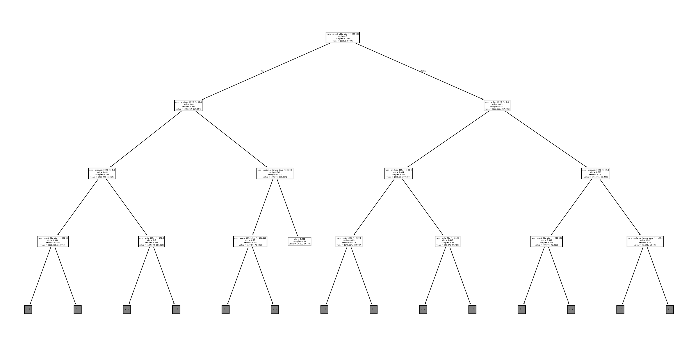

### Churn Partial Dependence

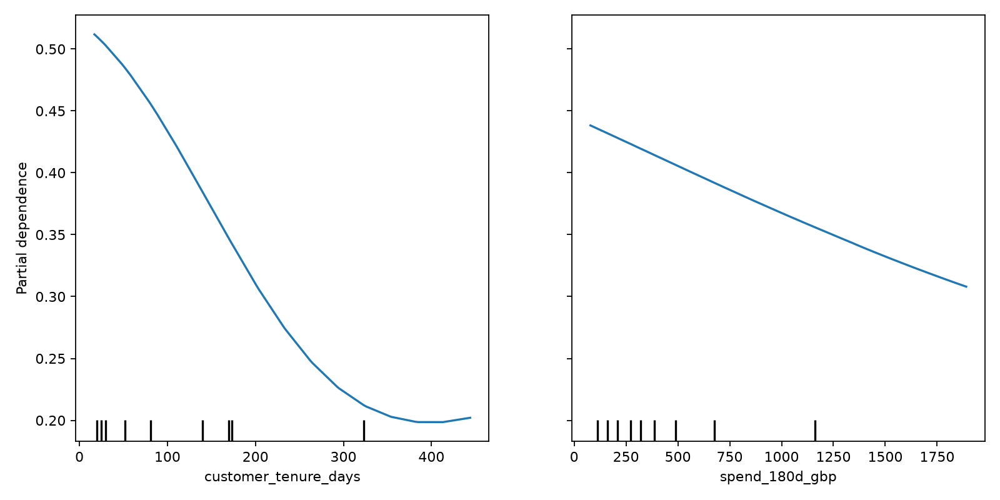

### Churn Permutation Importance

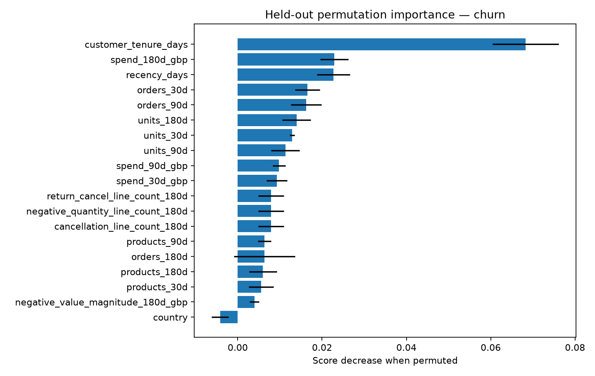

### Churn Shap Beeswarm

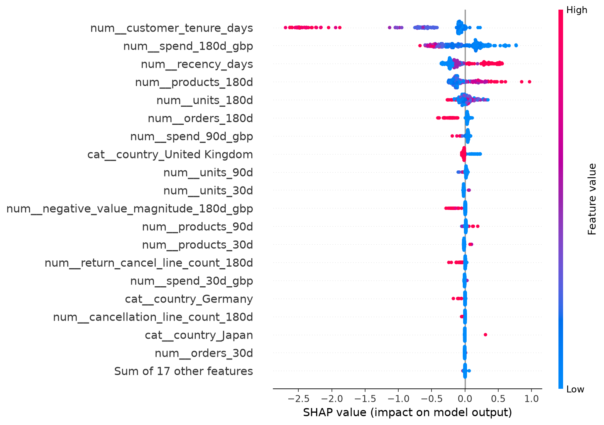

### Churn Shap Local Waterfall

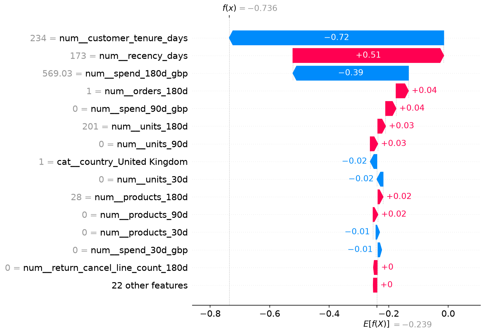

### Customer Segments Pca

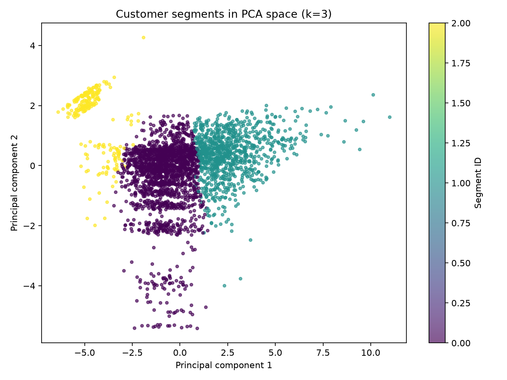

### Pca Explained Variance

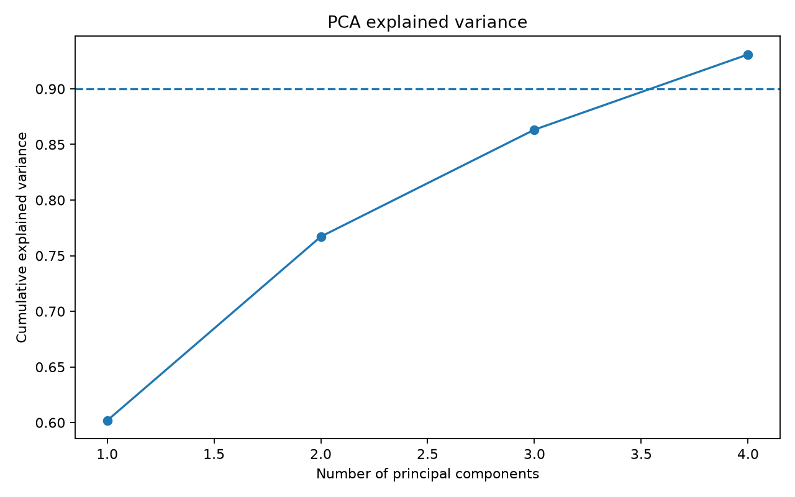

### Value Decision Tree Diagnostic

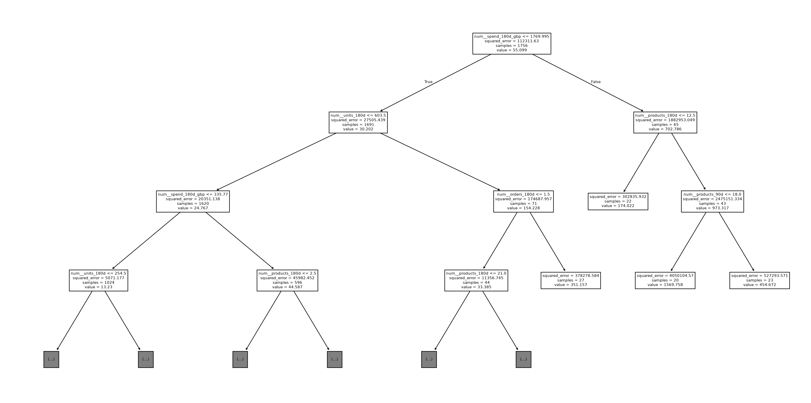

### Value Partial Dependence

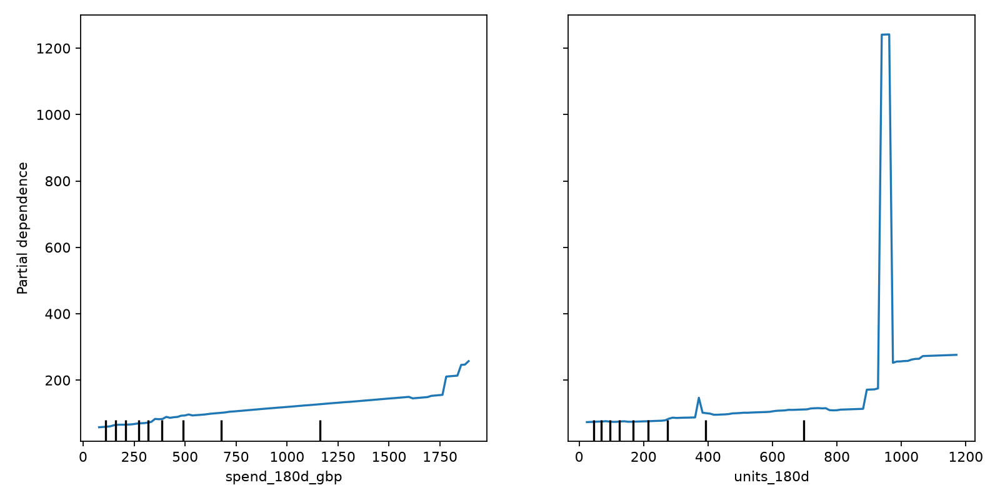

### Value Permutation Importance

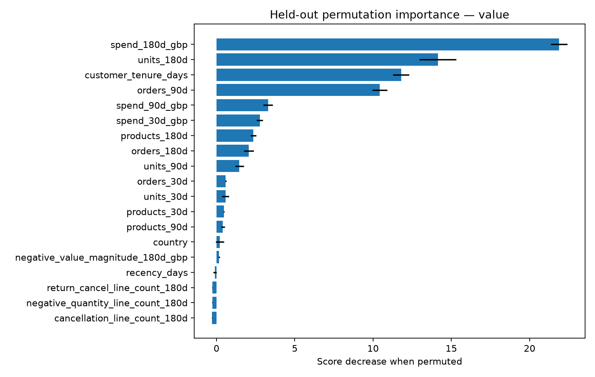

### Value Residual Diagnostics Validation

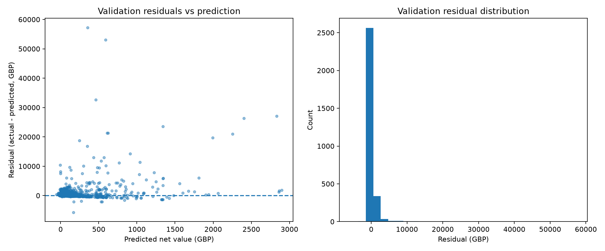

### Value Shap Beeswarm

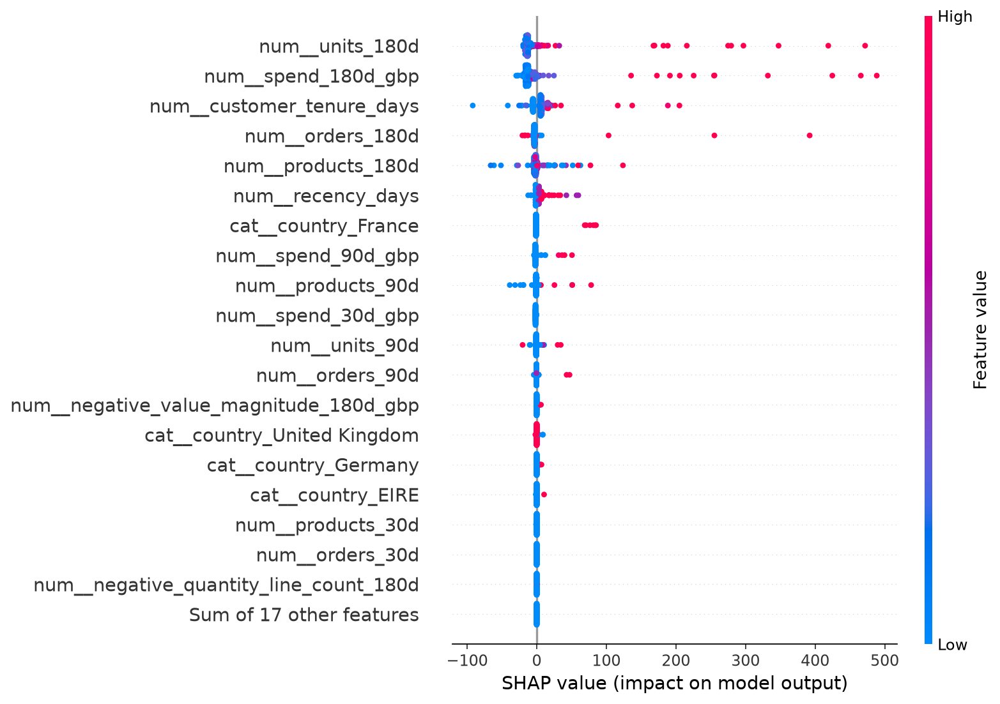

### Value Shap Local Waterfall

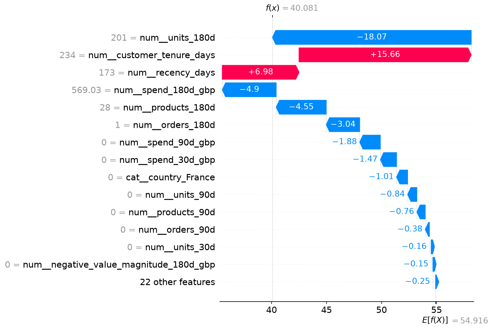

### Churn Calibration Reliability

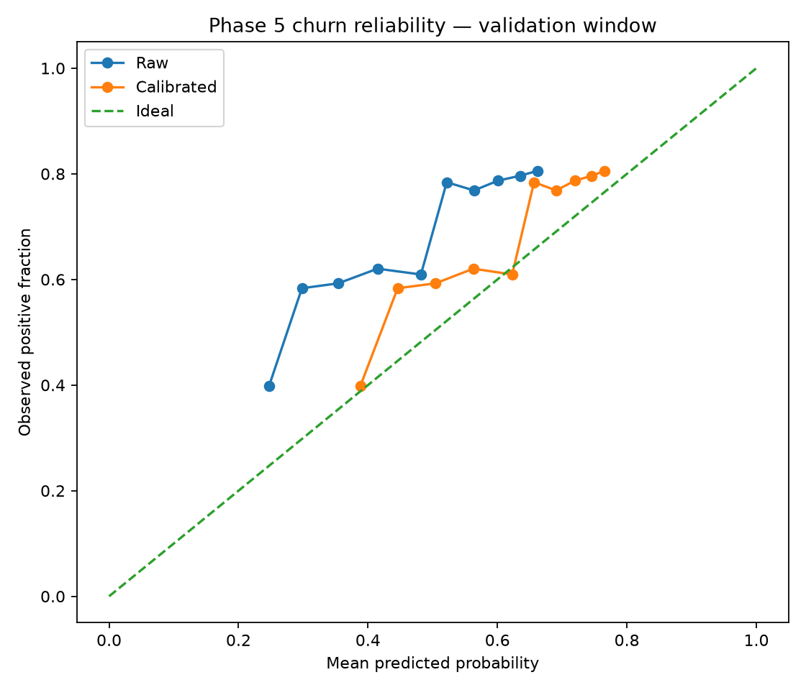

### Churn Shallow Tree Diagnostic

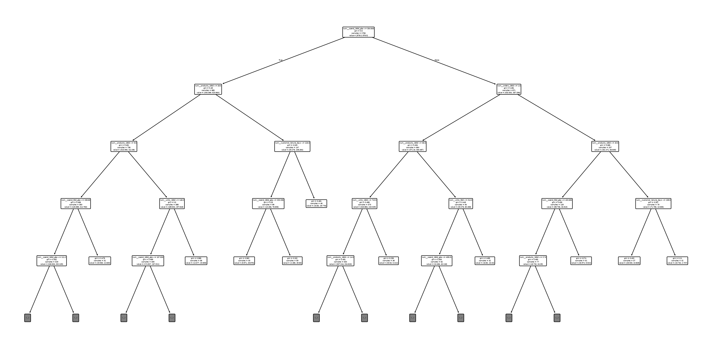

### Value Shallow Tree Diagnostic

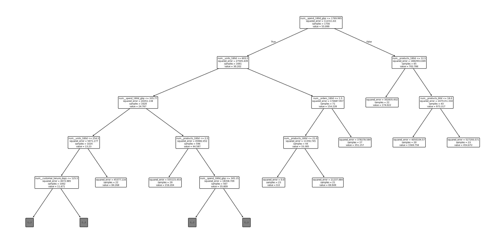

## Project layout

| Path | Purpose |
|---|---|
| `src/` | Application and modeling code |
| `tests/` | Automated tests |
| `configs/project.yaml` | Versioned project configuration |
| `reports/` | Generated metrics and visualizations |
| `data/` | Local datasets and processed data; ignored by Git |
| `models/` | Local trained model artifacts; ignored by Git |

## Verification

- Current test suite: **30 passed**.
- Numerical values are generated from local report artifacts and should be refreshed after a new modeling run.
